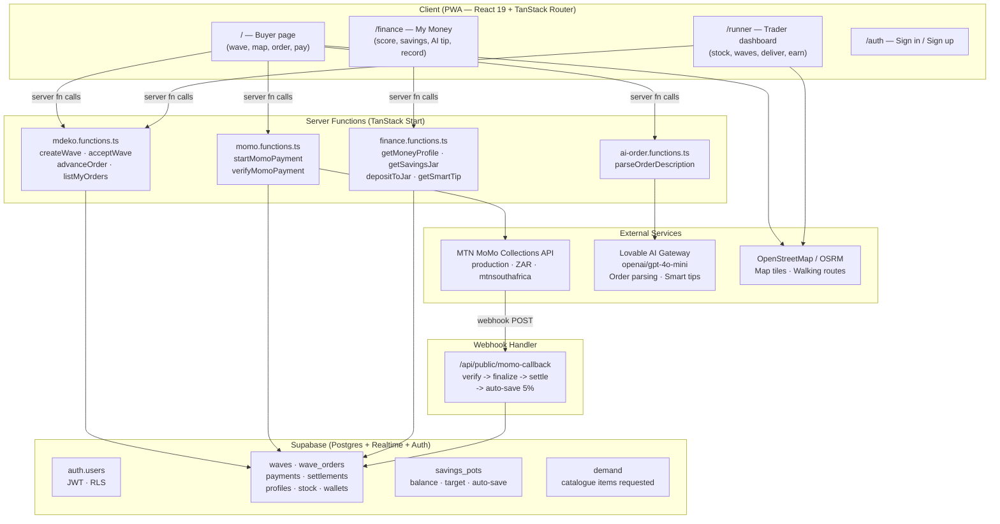
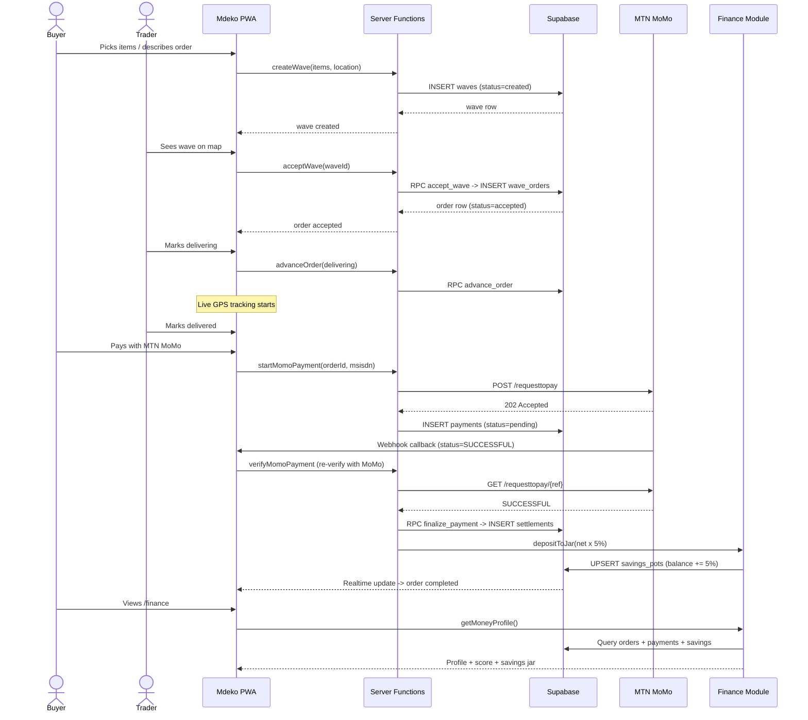
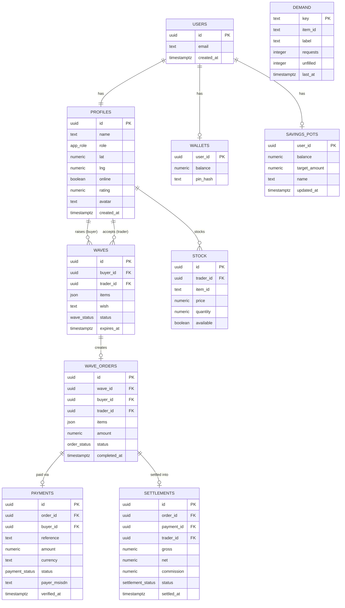
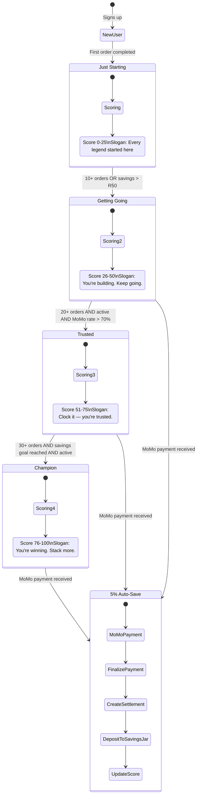
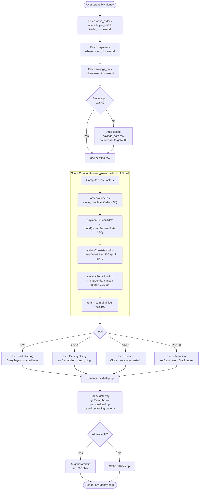

# Mdeko · Veggie Wave

Mdeko Veggie Wave is a township produce marketplace that connects buyers with nearby veggie traders through a map-based, mobile-first flow: a buyer raises a "wave", the closest trader accepts, an order is fulfilled, payment is completed, and the settlement is recorded in the finance profile.

Built with React 19, TanStack Start, Leaflet, Tailwind CSS v4, and a Supabase backend.

---

## The flow

```text
Buyer → Wave → Trader accepts → Order → MTN MoMo payment → Delivery → Complete → Settlement → Finance profile updated
```

---

## Architecture & UML

> These diagrams are generated from the live codebase structure and update automatically as the system evolves. They represent the current state of the application at the time of the last commit.

### System Architecture — Component Diagram



---

### Core Order Flow — Sequence Diagram



---

### Database Schema — Entity Relationship Diagram



---

### Mdeko Finance — State Machine



---

### Finance Score Algorithm — Activity Diagram



---

## Features

### Buyer experience (`/`)

- Browse a produce catalogue with icons, quantities, and trader prices.
- Describe your order in words — an AI assistant converts a free-text description into an itemised order; unrecognised items are logged as demand.
- See nearby traders on a live OpenStreetMap, ranked by stock match and distance, with walking-time estimates.
- Real browser geolocation with a manual pin-drop fallback.
- Raise a wave and track it through a status stepper: waving → on the way → delivered → paid.
- Pay with MTN MoMo (request-to-pay to the buyer's phone).

### Trader experience (`/runner`)

- Stall dashboard with online/offline availability toggle.
- Profile with photo upload.
- Full stock management — per-item availability, price, and quantity.
- Incoming waves with accept / deliver / request-payment actions.
- Demand insights — see what buyers are asking for that nobody stocks.
- Earnings and settlement tracking.

### Mdeko Finance (`/finance`)

- Community Credit Score (0–100) computed from real order and payment data — four factors: volume, reliability, activity, savings.
- Tiers with youth-first slogans: Just Starting → Getting Going → Trusted ("Clock it") → Champion ("Stack more").
- Stack it — savings jar that auto-grows by 5% of every MoMo settlement, no action needed.
- AI Smart Tip — personalised weekly money advice generated from your actual trading patterns.
- Your Record — a shareable financial identity card: orders done, total traded, member since.
- How Mdeko works — transparent breakdown of revenue streams and break-even numbers.
- Multilingual: English / Zulu / Sesotho — full page translates instantly.

### Backend & integrations

- Supabase (Lovable Cloud): auth, profiles, wallets, savings_pots, catalogue, stock, waves, orders, payments, settlements, demand — all protected by row-level security.
- MTN MoMo Collections (production, `mtnsouthafrica`, ZAR): server-side token management, idempotent request-to-pay, webhook re-verification before settlement. 5% auto-save fires in the webhook callback.
- AI order parsing + Smart Tips: Lovable AI gateway → order parsing and personalised finance coaching.
- Weather alerts and walking-route guidance during delivery.

---

## Tech stack

- React 19 + TanStack Start / Router
- Vite 7
- Tailwind CSS v4
- Leaflet + OpenStreetMap tiles
- Supabase (auth, database, realtime)
- MTN MoMo Collections API
- Radix UI primitives, Lucide icons, sonner toasts

---

## Project structure

```text
.
├── src/
│   ├── components/
│   │   ├── ui/
│   │   ├── BrandMark.tsx
│   │   ├── DemandInsights.tsx
│   │   ├── DescribeOrder.tsx
│   │   ├── NavigationTracker.tsx
│   │   ├── OrderStepper.tsx
│   │   ├── StockEditor.tsx
│   │   ├── VeggieMap.tsx
│   │   └── WavePayDialog.tsx
│   ├── lib/
│   │   ├── ai-order.functions.ts    # AI describe-to-order server fn
│   │   ├── ai-order.server.ts
│   │   ├── finance.functions.ts     # Finance: savings jar, money profile, AI tip
│   │   ├── finance-score.ts         # Community Credit Score algorithm
│   │   ├── use-finance.ts           # React Query hooks for finance
│   │   ├── mdeko.functions.ts       # wave/order/payment server API
│   │   ├── momo.server.ts           # MTN MoMo client
│   │   ├── momo.functions.ts
│   │   ├── veggie-store-supabase.ts
│   │   ├── veggie-store.ts          # legacy local demo store
│   │   ├── veggie-data.ts           # catalogue, icons, distance helpers
│   │   ├── use-geolocation.ts       # watchPosition-based GPS hook
│   │   └── ...                      # weather, routing, tracking, session hooks
│   ├── routes/
│   │   ├── __root.tsx
│   │   ├── index.tsx                # buyer page
│   │   ├── runner.tsx               # trader dashboard
│   │   ├── finance.tsx              # My Money — financial inclusion feature
│   │   ├── auth.tsx                 # sign in / sign up
│   │   └── api/public/              # MoMo webhook callback (+ auto-save)
│   ├── router.tsx
│   ├── start.ts
│   └── styles.css
├── supabase/
│   └── migrations/
│       └── 20261023000000_add_savings_pots.sql
├── docs/screenshots/
├── .env.example
└── README.md
```

---

## Getting started

### Prerequisites

- Node.js or Bun
- A Supabase project (or Lovable Cloud) with the migrations in `supabase/` applied
- MTN MoMo Collections credentials (API user, API key, subscription key)

### Install & run

```bash
bun install
bun run dev
```

### Lint & build

```bash
npm run lint
npm run build
```

### Environment variables

Copy `.env.example` and fill in:

| Variable | Purpose |
| --- | --- |
| `VITE_SUPABASE_URL` / `VITE_SUPABASE_PUBLISHABLE_KEY` | Client-side Supabase config |
| `SUPABASE_URL` / `SUPABASE_PUBLISHABLE_KEY` | Server-side Supabase config |
| `MOMO_BASE_URL` | `https://proxy.momoapi.mtn.com` (production) |
| `MOMO_SUBSCRIPTION_KEY` | Ocp-Apim-Subscription-Key |
| `MOMO_API_USER` / `MOMO_API_KEY` | Basic-auth credentials for token generation |
| `MOMO_TARGET_ENVIRONMENT` | `mtnsouthafrica` |
| `MOMO_CURRENCY` | `ZAR` |
| `LOVABLE_API_KEY` | AI gateway — order parsing and Smart Tips |

MoMo secrets are read inside server handlers only — never exposed to the browser.

---

## Payments: MTN MoMo flow

1. Token — `POST /collection/token/` with Basic auth (base64 of `API_USER:API_KEY`) plus the subscription key and `X-Target-Environment`. Tokens are cached server-side and refreshed before expiry.
2. Request to pay — `POST /collection/v1_0/requesttopay` with a unique UUID `X-Reference-Id` per transaction, amount in ZAR, MSISDN normalised to `27XXXXXXXXX`.
3. Status — `GET /collection/v1_0/requesttopay/{referenceId}`; the webhook re-verifies with MTN before settling. On success, 5% of the net settlement is automatically deposited into the trader's savings jar.

---

## Deployment

A GitHub Actions workflow (`.github/workflows/deploy.yml`) deploys to Netlify on every push to `main`. Set `NETLIFY_AUTH_TOKEN` and `NETLIFY_SITE_ID` as GitHub repository secrets.

---

## License

This project is provided as-is for demonstration and development use.

