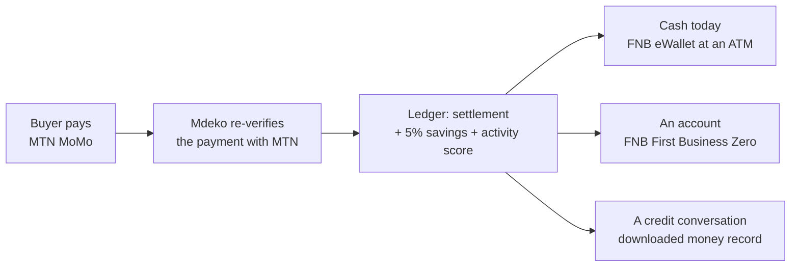
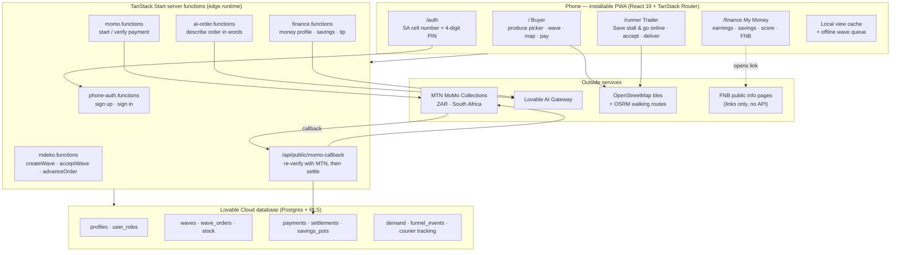
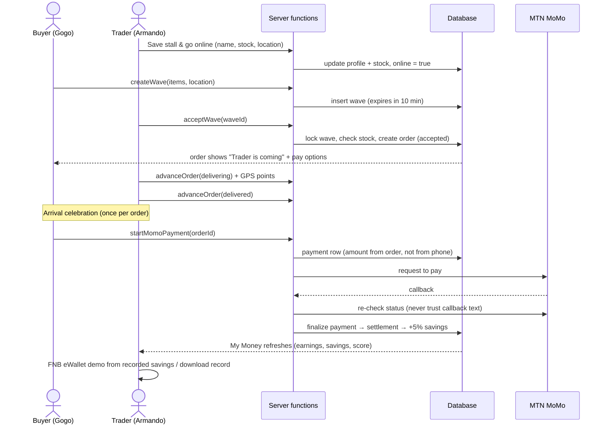
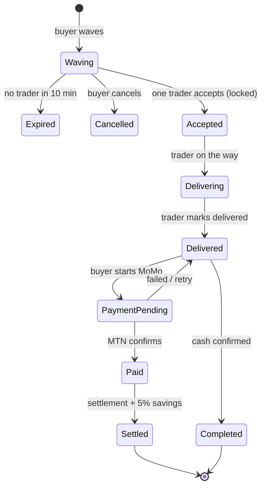
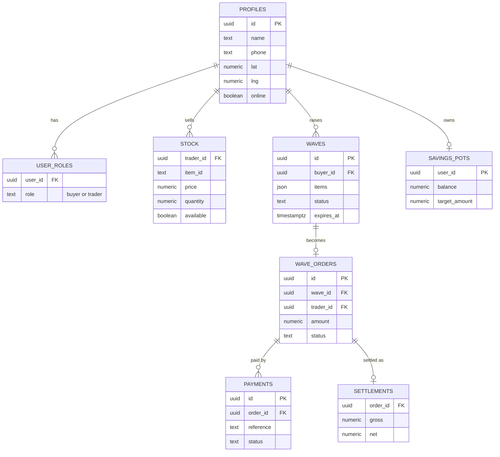
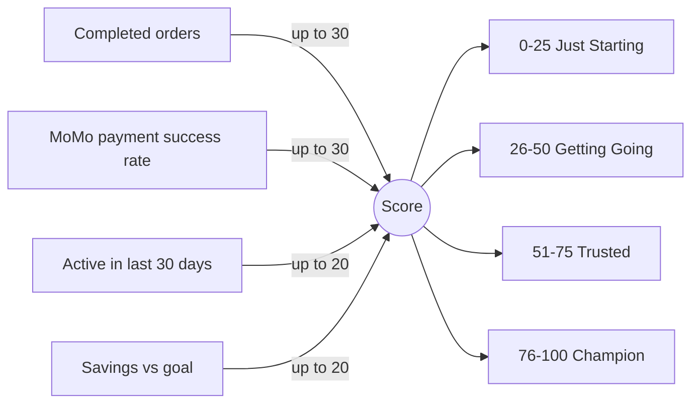

# Mdeko · Veggie Wave

> **Raise your hand. The trolley comes to you. Every sale builds a money record.**

Mdeko is a mobile-first web app (PWA) for township street produce. A buyer taps the veggies they want and **waves**. The nearest online trolley trader sees the wave on a live map, accepts it and walks straight to the buyer. Payment goes through **MTN MoMo** (or cash), 5% of every verified MoMo settlement goes into the trader's **savings pot**, and every sale builds a **money record** the trader can download and take to a bank such as FNB.

- **Live app:** https://veggie-wave-delivery.lovable.app
- **Main screens:** `/` buyer · `/runner` trader · `/finance` My Money · `/auth` cell number + PIN sign-in

---

## Table of contents

1. [Why we built this](#1-why-we-built-this)
2. [Who it is for](#2-who-it-is-for)
3. [How the app works](#3-how-the-app-works)
4. [Screenshots](#4-screenshots)
5. [Architecture diagrams](#5-architecture-diagrams)
6. [Why this stack](#6-why-this-stack)
7. [Features by screen](#7-features-by-screen)
8. [Security and money rules](#8-security-and-money-rules)
9. [Run it locally](#9-run-it-locally)
10. [Testing and evidence](#10-testing-and-evidence)
11. [Judge demo guide (90 seconds)](#11-judge-demo-guide-90-seconds)
12. [Honest limits and what is next](#12-honest-limits-and-what-is-next)
13. [Project structure](#13-project-structure)

---

## 1. Why we built this

The founder started out selling vegetables with his grandmother at a stall in **Ivory Park**. Competition at the big market was tough, so they bought a trolley and pushed it through the streets. It was hard work: hot days, rain, and no way of knowing where the customers were. The question back then was simple:

> *What if somebody could just raise their hand, and I would know exactly where to go?*

Years later, two problems are still there:

| Problem | Effect |
| --- | --- |
| Trolley traders walk around hoping to find buyers | Wasted energy, unsold stock, and stock based on guesses instead of what people want |
| Buyers (often older people) miss traders who pass in a rush | Family members drive to a mall for fresh produce |
| Sales are cash-only and nothing is written down | Traders have no record, so banks can't see them and they can't get credit to grow |
| Traders carry cash to the fresh produce market at dawn | Risk of being robbed, and money sent home leaves nothing to start again with |

---

## 2. Who it is for

**Armando, the trader.** He has run a trolley business, inherited from his cousin, for four years. He splits his life between South Africa and Malawi. Most of what he earns goes home, so every time he comes back he starts from zero. He has no card machine, no bank record and carries cash to the Joburg Fresh Produce Market. He wants to grow, but nobody can see what he earns.

**Gogo, the buyer.** She wants fresh tomatoes and spinach at her gate. Trolley sellers rush past her, so her grandchild has to go to the mall. With Mdeko she taps two pictures and waves.

---

## 3. How the app works

```text
 BUYER                         MDEKO                            TRADER
 ─────                         ─────                            ──────
 Tap veggie icons ──► Wave (10-min window) ──► Shows on map of nearby online traders
                                                      │
                                    Trader taps Accept (database lock: one trader only,
                                    stock checked, price from trader's saved stock)
                                                      │
 Sees "On the way" + live pin ◄── Trader shares walking progress (GPS + route)
                                                      │
 Celebration when trader arrives ◄── Trader marks Delivered
                                                      │
 Pays with MTN MoMo or cash ──► Payment checked again with MTN (never trusted from callback text)
                                                      │
                               Settlement recorded ──► 5% of net goes to trader savings pot
                                                      │
                               My Money updates: earnings, savings, Mdeko activity score
                                                      │
                               FNB bridge: eWallet cash-out demo + downloadable money record
```

### The three-step money story

1. **MTN MoMo collects on the street** — no card machine needed, just the buyer's phone.
2. **Mdeko builds the record** — every verified sale, settlement and the 5% saving is stored.
3. **FNB is the way out to formal banking** — eWallet cash-out at an ATM (shown as a demo using the trader's real recorded savings), and a downloadable record for an FNB business account or loan conversation.

> Mdeko is **not** partnered with FNB. FNB features are clearly labelled in the app as information links and a local demo. No real money moves through them.

### How we use FNB

Mdeko never holds or moves money. MoMo does the collecting, Mdeko does the writing-down, and FNB is where the written-down money becomes usable off the street. A trader meets FNB at three points, in this order:

| Touchpoint | What the trader does | Where it is in the app | Status today |
| --- | --- | --- | --- |
| **FNB eWallet cash-out** | Sends recorded savings to their own cell number and withdraws cash at any FNB ATM with a PIN — no bank card, no branch queue, no trolley full of rands | My Money → *Cash out with FNB eWallet* | **Local demo.** The amount is capped by the trader's real recorded savings, the SMS and ATM steps are simulated, and nothing is sent to FNB |
| **FNB First Business Zero** | Opens a business account for sole proprietors once there is a sales record worth showing | My Money → bank panel → *Explore account at FNB* | **Information link** to fnb.co.za. Mdeko does not apply on the trader's behalf and does not see the outcome |
| **Money record for credit** | Takes a downloadable record of sales, settlements, savings and activity into a lender conversation | My Money → *View full record* → *Download record for FNB review* | **Real CSV**, written to the trader's own phone. It is never uploaded and never sent to FNB |



**Why FNB specifically:** eWallet is the only leg a trader like Armando can use today — it needs a cell number, not a bank account or a card machine. First Business Zero and SME lending then give the ledger somewhere to go, which is the reason the ledger exists at all.

**What a live version needs:** an FNB partnership with signed agreements, access to FNB's Open API for eWallet initiation and status, KYC on the receiving cell number, and a reconciliation job that matches FNB's records to Mdeko's settlements. None of that is built or claimed here.

> Terminology for judges and copy: **eWallet** is FNB's cash remittance service (the cash-out tool). **eBucks** is FNB's rewards programme. They are different products — the app and this README say *eWallet*.


---

## 4. Screenshots

| Buyer — pick veggies and wave | Trader — stall, stock and incoming waves |
| --- | --- |
|  |  |

---

## 5. Architecture diagrams

### 5.1 System architecture



### 5.2 End-to-end sequence



### 5.3 Order lifecycle



### 5.4 Database (main tables)



Also: `demand` (what buyers ask for that nobody stocks), `funnel_events` (anonymous usage steps) and courier tracking points (limited to recent points).

### 5.5 Mdeko activity score (0–100)



The score only changes from real confirmed activity. It is an **activity score, not a bank credit score**.

---

## 6. Why this stack

| Choice | Why it fits township traders |
| --- | --- |
| **PWA instead of an app-store app** | No big download, saves data, installs from the browser to the home screen, works on cheap Android phones. |
| **React 19 + TanStack Start** | One typed codebase for screens and server code. Server functions keep MoMo and AI keys on the server, never on the phone. Pages render on the server so the first screen shows fast on slow networks. |
| **Edge runtime (Cloudflare Workers)** | Starts fast, runs close to the user, and costs nothing when idle, which suits a pilot with spiky demand. |
| **Lovable Cloud (Postgres)** | Money needs real transactions: locking a wave so only one trader gets it, stopping stock from going negative, and stopping a settlement from being paid twice. Row-level security keeps each person's records private. |
| **Cell number + 4-digit PIN** | Matches how people already use MoMo and USSD. No email needed. The cell number is also the MoMo number. |
| **MTN MoMo Collections** | Traders get paid without renting a card machine. The server checks the payment with MTN again before recording money. |
| **FNB as the banking bridge** | eWallet reaches traders who have no bank account and no card machine, and First Business Zero plus SME lending give the written-down record somewhere to go. Today Mdeko only links to public FNB pages and simulates the cash-out locally — a real integration needs an FNB partnership and Open API access. |
| **Leaflet + OpenStreetMap + OSRM** | Light maps with no per-view billing, and walking routes that suit trolley traders. |
| **Lovable AI Gateway** | "Describe your order in words" and short money tips, without managing AI keys. |
| **Tailwind CSS v4 + shared colour tokens** | Small CSS, no runtime styling cost on low-end phones, one consistent look. |
| **Bun + Vitest + Playwright** | Fast installs, unit tests for money and location rules, and real browser checks of the main flow. |

---

## 7. Features by screen

### Buyer — `/`
- Big produce icons with simple quantity buttons; waving stays one tap away.
- Nearby online traders on a live map (about 6 km), sorted by distance and what they stock.
- Live GPS with manual pin-drop fallback; low-accuracy fixes are labelled "approximate".
- Order steps: waving → coming → delivered → paid. Pay buttons appear as soon as a trader accepts.
- Pay with MTN MoMo (cell number filled in from sign-up) or cash.
- Optional: describe the order in words (AI), group restock, weather.
- If the internet drops, the wave is saved and sent when it comes back.

### Trader — `/runner`
- One **Save stall & go online** button saves the name, prices and amounts and switches the stall online.
- Incoming waves nearby, with accept / on the way / delivered.
- Walking route and live position shared with the buyer.
- Demand insights: what buyers ask for that nobody stocks.

### My Money — `/finance`
- Stall earnings, kept apart as recorded sales, waiting for settlement, and available.
- Savings pot (5% of verified MoMo settlements) and Mdeko activity score with tips.
- **FNB eWallet cash-out demo**: choose an amount from your **real recorded savings**, see a sample SMS and ATM steps. The demo balance can't go below zero. Clearly labelled *Demo simulation · no real money moves*.
- **FNB First Business Zero** info and **Download record for FNB review** (CSV saved to the phone, never sent anywhere).
- Optional bank link with labelled sandbox data.

---

## 8. Security and money rules

- **Roles come from the database** (`user_roles`), never from browser storage.
- **Order, payment and delivery changes run only through checked server functions** that use the signed-in user's identity. The phone can't pretend to be someone else.
- **Amounts are worked out on the server** from the order, not sent from the phone.
- **Payment success is always re-checked with MTN**; a callback alone never marks an order paid.
- **Duplicate taps reuse the same payment**; one order can only be settled once.
- **Typed manual deposits can't add money.** Only verified payments and settlements change balances.
- **CSV export guards against spreadsheet formula injection.**
- **Read limits:** discovery only reads online traders inside a small area box with a cap, and tracking keeps only recent points.

---

## 9. Run it locally

```bash
bun install
bun run dev        # http://localhost:8080
bun run lint
bunx vitest run
```

Copy `.env.example` to `.env`:

| Variable | Purpose |
| --- | --- |
| `VITE_SUPABASE_URL`, `VITE_SUPABASE_PUBLISHABLE_KEY` | Public database connection for the browser |
| `SUPABASE_URL`, `SUPABASE_PUBLISHABLE_KEY` | Same connection on the server |
| `MOMO_BASE_URL`, `MOMO_SUBSCRIPTION_KEY`, `MOMO_API_USER`, `MOMO_API_KEY` | MTN MoMo Collections (server only) |
| `MOMO_TARGET_ENVIRONMENT`, `MOMO_CURRENCY` | e.g. `mtnsouthafrica`, `ZAR` |
| `LOVABLE_API_KEY` | AI order parsing and tips (server only) |

Database migrations live in `drizzle/migrations/`. Deployment runs from `.github/workflows/deploy.yml`.

---

## 10. Testing and evidence

- **Unit tests** (`bunx vitest run`): phone/PIN rules, MoMo configuration, payment status, nearby traders, GPS handling, wave views, finance score, trader finance, eWallet demo balance, CSV record, delivery celebrations, journey steps, group restock and more.
- **Database checks:** `tests/db/judge-security.sql` (who can call what) and `tests/db/money-rules.sql` (no double settlement, server-set amounts, exactly R5 saved on R100 net, strangers can't read orders). Run inside a transaction that is rolled back.
- **Browser checks** with Playwright on phone sizes (320–393 px): sign-in, waving, My Money, eWallet demo and CSV download.
- Full review notes: [`docs/judge-readiness.md`](docs/judge-readiness.md).

---

## 11. Judge demo guide (90 seconds)

Open two tabs side by side: **buyer** on the left, **trader** on the right.

1. **Trader:** set prices → **Save stall & go online**.
2. **Buyer:** tap tomatoes + onions → **Wave**.
3. **Trader:** accept → on the way → **Delivered** (celebration plays).
4. **Buyer:** pay (MoMo or cash).
5. **Trader → My Money:** earnings, 5% savings, score → **FNB eWallet cash-out** demo → **Download record for FNB review**.

> *"MoMo takes the payment on the street. Mdeko builds the record. FNB brings him into banking."*

---

## 12. Honest limits and what is next

| Live and working | Demo or not yet proven |
| --- | --- |
| Waves, accept lock, stock checks, delivery tracking | No real customer MoMo payment completed end to end yet (token check works) |
| Cash and MoMo order flow, 5% savings record | Settlement is a record, not an automatic payout |
| My Money earnings, savings, activity score | FNB eWallet is a local demo; no FNB partnership or API |
| CSV money record download | Bank link shows labelled sandbox data |
| Offline wave queue | 4-digit PIN and unverified phone ownership are not production-grade identity |
| | No large-scale load test has been run |

**Next:** 90-day Ivory Park pilot, phone OTP verification, automatic MoMo payouts, an FNB partnership for real eWallet and SME credit, and group buying at the Joburg Fresh Produce Market.

Market figures used in the pitch are estimates until backed by a cited source (e.g. Stats SA QLFS).

---

## 13. Project structure

```text
src/
├── routes/
│   ├── index.tsx              # Buyer
│   ├── runner.tsx             # Trader
│   ├── finance.tsx            # My Money
│   ├── auth.tsx, auth/        # Cell + PIN sign-in, onboarding
│   └── api/public/momo-callback.ts
├── components/                # Map, produce picker, pay dialog, FNB options, celebrations…
├── lib/
│   ├── *.functions.ts         # Server functions (marketplace, MoMo, finance, AI, auth)
│   ├── *.server.ts            # Server-only clients (MoMo, AI, routing, weather)
│   ├── ewallet-demo.ts        # Balance-safe eWallet simulation
│   ├── finance-record.ts      # CSV money record
│   ├── finance-score.ts       # Activity score
│   └── *.test.ts              # Unit tests
drizzle/migrations/            # Database schema
tests/db/                      # Security and money SQL checks
docs/                          # Judge readiness + screenshots
```

---

Provided as-is for demonstration and development use.
