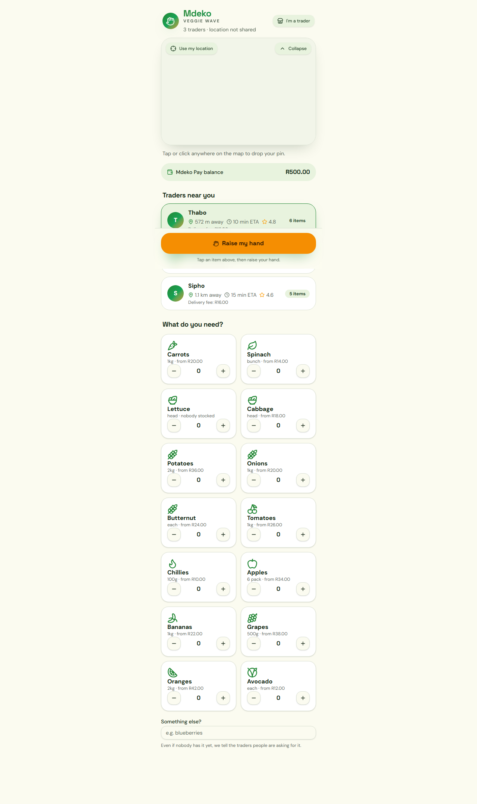
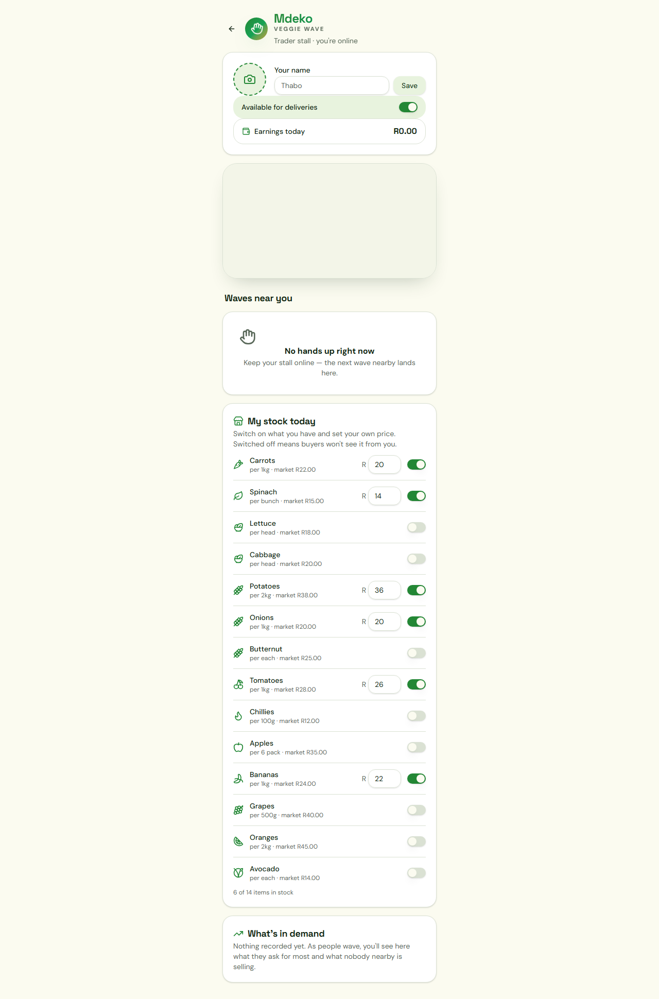

# Mdeko · Veggie Wave

Mdeko Veggie Wave is a local produce ordering prototype that connects buyers with nearby veggie traders through a map-based, mobile-first flow.

This version is a working demo app built in React with TanStack Router, Leaflet, and local state persistence. It shows the core experience we built:

- buyers browse produce and raise a wave for help,
- nearby traders appear on a live map,
- a trader can accept a request, deliver, and request payment,
- the buyer can pay using a demo Wave Pay balance or cash,
- the app remembers the state in browser local storage for the prototype experience.

---

## What we built

### Buyer experience
The buyer journey is centered around a map and a produce catalogue.

Users can:
- browse produce by category and quantity,
- see nearby traders ranked by stock match and distance,
- use their location or manually pin a delivery point,
- raise a wave when they need fresh produce,
- track the order from “waving” to “accepted” to “delivered” to “paid”,
- pay via Wave Pay balance or cash.

### Trader experience
The trader view is a stall dashboard.

Traders can:
- toggle availability online/offline,
- update their name and profile picture,
- adjust stock and item prices,
- see incoming customer waves near their stall,
- accept a wave, confirm delivery, and request payment,
- review earnings and delivery progression.

### Core product feel
The app is deliberately designed as a lightweight local-market UX prototype, with:
- a leafy, warm visual style,
- mobile-first layout,
- map-based proximity logic,
- local demo pricing and stock simulation,
- a transaction flow that feels like a working MVP rather than a static mock.

---

## Screenshots

### Buyer view



### Trader view



---

## Tech stack

- React 19
- TanStack Router + TanStack Start
- Vite
- Tailwind CSS v4
- Leaflet + OpenStreetMap tiles
- Radix UI primitives
- Lucide React icons
- localStorage-based state persistence for prototype/demo behavior

---

## Project structure

```text
.
├── src/
│   ├── components/
│   │   ├── ui/
│   │   ├── BrandMark.tsx
│   │   ├── DemandInsights.tsx
│   │   ├── OrderStepper.tsx
│   │   ├── StockEditor.tsx
│   │   ├── VeggieMap.tsx
│   │   └── WavePayDialog.tsx
│   ├── hooks/
│   ├── integrations/
│   ├── lib/
│   │   ├── use-geolocation.ts
│   │   ├── utils.ts
│   │   ├── veggie-data.ts
│   │   └── veggie-store.ts
│   ├── routes/
│   │   ├── __root.tsx
│   │   ├── index.tsx
│   │   └── runner.tsx
│   ├── router.tsx
│   ├── routeTree.gen.ts
│   ├── server.ts
│   ├── start.ts
│   └── styles.css
├── public/
├── supabase/
├── docs/
│   └── screenshots/
├── AGENTS.md
├── components.json
├── eslint.config.js
├── package.json
├── tsconfig.json
├── vite.config.ts
├── bunfig.toml
└── README.md
```

---

## Getting started

### Prerequisites

- Node.js
- npm

This repo was originally intended to use Bun, but in this environment the project has been verified using npm as the working equivalent.

### Install dependencies

```bash
npm install
```

### Run the app locally

```bash
npm run dev -- --host 0.0.0.0
```

Then open the local URL shown in the terminal, normally:

```text
http://localhost:8081/
```

### Lint the project

```bash
npm run lint
```

### Production build

```bash
npm run build
```

---

## Demo flow

1. Open the buyer page.
2. Pick vegetables and quantities.
3. Click “Raise my hand”.
4. See nearby traders ranked by stock match and distance.
5. Switch to the trader view.
6. Accept a wave and complete the delivery flow.
7. Confirm payment through the demo payment flow.

---

## Notes

This is a front-end prototype and not yet a production backend integration. The current version intentionally simulates the marketplace logic with in-browser state and seeded demo data.

It is best understood as a proof of concept for:
- local produce discovery,
- community supply matching,
- delivery coordination,
- and lightweight wallet-based payment UX.

---

## License

This project is provided as-is for demo and prototype use.
